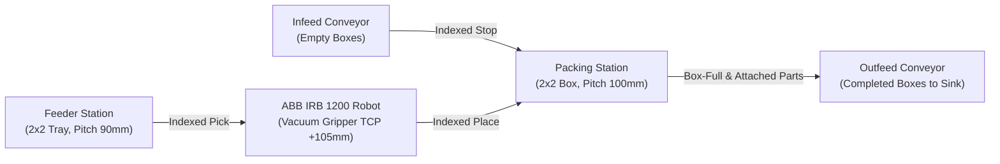
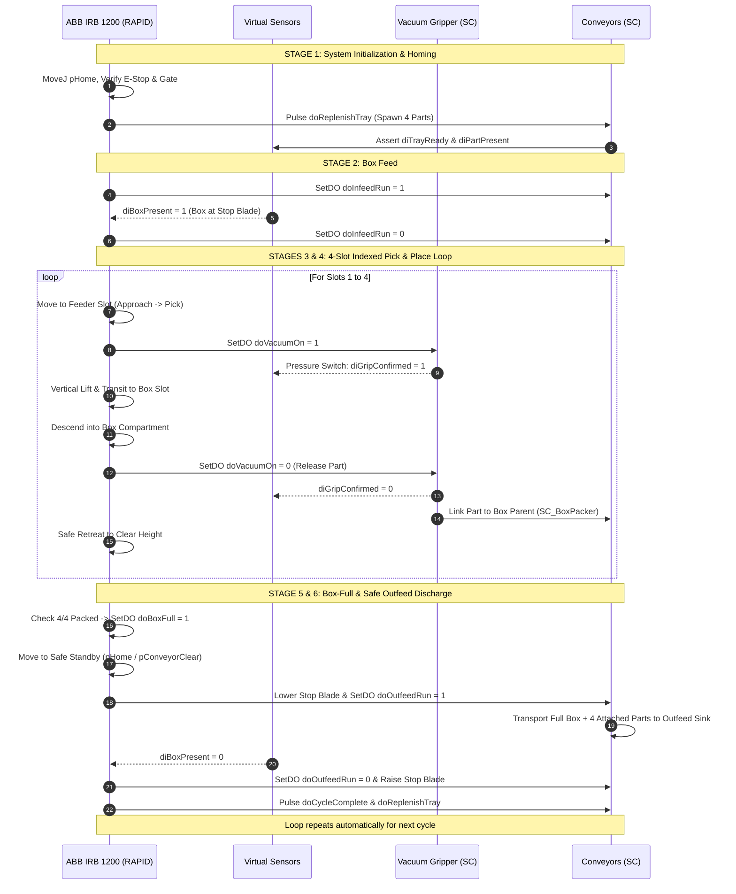

# Technical Project Report: Automated Tray-to-Box Packing Robotic Work Cell
## Topic 18 — Digital Twin Commissioning in ABB RobotStudio

---

## 1. Executive Summary

This engineering project delivers a fully simulated, signal-driven industrial **Digital Twin** of an automated packing cell designed around the **ABB IRB 1200-7/0.7** six-axis industrial robot. The cell automates the sequential transfer of manufactured workpieces from a 4-cavity 2×2 feeder tray into a 4-compartment 2×2 packing box, followed by automated discharge and replacement via dual conveyors.

Unlike static robot animations, this digital twin executes under the exact control of the **ABB Virtual Controller (IRC5 / OmniCore)** running genuine RAPID code. The simulation responds dynamically to virtual optical sensors, vacuum pressure switch feedback, and pneumatic cylinder interlocks implemented via **RobotStudio Smart Components**.

---

## 2. Industrial Requirements & Engineering Specifications

| Parameter | Feeder Station | Packing Box | Vacuum Gripper | Robot Arm | Conveyor System |
|---|---|---|---|---|---|
| **Envelope** | 220 × 220 × 35 mm | 240 × 240 × 65 mm | Ø63 mm × 105 mm | Reach: 703 mm | 320 mm × 2200 mm |
| **Grid Array** | 2×2 (4 Cavities) | 2×2 (4 Compartments)| Single Cup Bellows | 6 Revolute Axes | Infeed & Outfeed |
| **Grid Pitch** | 90.0 mm (±45 mm) | 100.0 mm (±50 mm) | TCP: Z = +105.0 mm | Base: (0,0,0) | Velocity: 150-200 mm/s |
| **Part Size** | 45 × 45 × 30 mm | 50 × 50 mm Cavity | Vacuum Lip: Ø30 mm| Payload: 7.0 kg | Belt Bed with Guides |
| **Material** | Hard-Anodized Al | Molded Copolymer | Silicone / Aluminum| Cast Aluminum | Extruded Al Profile |
| **Sensing** | Retro-reflective | Optical PlaneSensor | Pressure Switch | Resolver Feedback | Optical Arrival & Exit |

---

## 3. Robot Selection & Kinematic Analysis

### 3.1 Robot Model: ABB IRB 1200-7/0.7
The ABB IRB 1200-7/0.7 was selected after rigorous reach and payload verification:
- **Maximum Horizontal Reach**: `703.0 mm`
- **Rated Payload**: `7.0 kg` (Total end-effector mass with workpiece is `0.970 kg`, utilizing only `13.8%` of payload capacity).
- **Position Repeatability**: `0.02 mm` (Far exceeding the required insertion clearance tolerance of `±2.5 mm`).
- **Wrist Protection**: IP40 standard / IP67 Foundry Plus.

### 3.2 Workspace Envelope & Target Radial Distances
The robot base is positioned at `(0, 0, 0)` mm:
- **Feeder Station Center**: `(350, -350, 465) mm` -> Radial Distance = `494.97 mm`
  - Slot 1: `(305, -395) mm` -> Distance = `499.0 mm`
  - Slot 2: `(395, -395) mm` -> Distance = `558.6 mm`
  - Slot 3: `(305, -305) mm` -> Distance = `431.3 mm`
  - Slot 4: `(395, -305) mm` -> Distance = `499.0 mm`
- **Packing Station Center**: `(350, +350, 435) mm` -> Radial Distance = `494.97 mm`
  - Slot 1: `(300, 300) mm` -> Distance = `424.3 mm`
  - Slot 2: `(400, 300) mm` -> Distance = `500.0 mm`
  - Slot 3: `(300, 400) mm` -> Distance = `500.0 mm`
  - Slot 4: `(400, 400) mm` -> Distance = `565.7 mm`

> [!NOTE]
> All pick and place coordinates fall squarely within the `424 mm to 566 mm` zone. This preserves a minimum of `137 mm` radial clearance from the outer reach boundary (`703 mm`) and `224 mm` clearance from the inner singularity cylinder (`< 200 mm`), ensuring maximum kinematic dexterity and zero singularity conditions during production.

---

## 4. Work Cell Operational Sequence

---

## 5. Safety Systems & Industrial Standards Compliance

1. **ISO 10218-1 / ISO 10218-2 Compliance**:
   - The cell incorporates a physical perimeter safety fence (2200 × 2000 × 1800 mm) with an interlocked safety access door (`diCellGateClosed`).
   - Emergency Stop circuit (`diEmergencyStop`) is dual-channel monitored.
2. **Software Safety Zoning**:
   - `doRobotInBoxZone`: Asserted whenever the robot arm enters the conveyor envelope. Hard-interlocked in Station Logic to prohibit conveyor motion while the robot is active inside the zone.
   - `doRobotInHome`: Signals supervisory SCADA / PLC that the robot is in safe standby.
3. **Fail-Safe Vacuum Logic**:
   - If vacuum feedback (`diGripConfirmed`) drops prematurely during transfer, the robot halts immediate path execution, enters a controlled vertical retreat, raises `doCellAlarm`, and pauses execution to prevent part damage.
