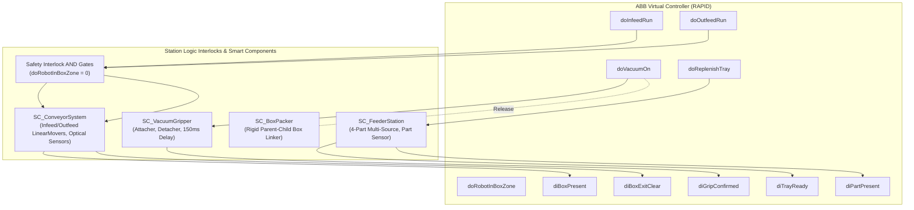

# RobotStudio Station Logic & Signal Handshaking Guide
## Project 18 — Digital Twin Commissioning: Automated Tray-to-Box Packing

---

## 1. Overview of Station Logic

The **Station Logic** window in ABB RobotStudio acts as the programmable software backplane connecting the **ABB Virtual Controller (RAPID runtime)** with the **Smart Components (Digital Twin simulation elements)**.

---

## 2. Complete Station Logic Connection Table

Open the **Simulation** ribbon tab in RobotStudio, click **Station Logic**, and navigate to the **Design** tab. Configure the following I/O connections:

| Connection # | Source Component | Source Port | Target Component | Target Port | Logic Function |
|---|---|---|---|---|---|
| **1** | `IRB1200_Packing_Controller` | `doVacuumOn` | `SC_VacuumGripper` | `doVacuumOn` | Initiates vacuum suction grip |
| **2** | `SC_VacuumGripper` | `diGripConfirmed` | `IRB1200_Packing_Controller` | `diGripConfirmed` | Pressure switch signal (<-75 kPa) |
| **3** | `IRB1200_Packing_Controller` | `doReplenishTray` | `SC_FeederStation` | `doReplenishTray` | Triggers 4-part replenishment |
| **4** | `SC_FeederStation` | `diTrayReady` | `IRB1200_Packing_Controller` | `diTrayReady` | Confirms feeder tray populated |
| **5** | `SC_FeederStation` | `diPartPresent` | `IRB1200_Packing_Controller` | `diPartPresent` | Confirms part ready for pick |
| **6** | `IRB1200_Packing_Controller` | `doInfeedRun` | `Gate_InfeedInterlock` | `InputA` | Infeed run request |
| **7** | `Gate_RobotClearBox` | `Output` | `Gate_InfeedInterlock` | `InputB` | Robot NOT in box zone interlock |
| **8** | `Gate_InfeedInterlock` | `Output` | `SC_ConveyorSystem` | `doInfeedRun` | Powers infeed conveyor motor |
| **9** | `SC_ConveyorSystem` | `diBoxPresent` | `IRB1200_Packing_Controller` | `diBoxPresent` | Box arrived at packing station |
| **10**| `IRB1200_Packing_Controller` | `doOutfeedRun` | `Gate_OutfeedInterlock`| `InputA` | Outfeed run request |
| **11**| `Gate_RobotClearBox` | `Output` | `Gate_OutfeedInterlock`| `InputB` | Robot NOT in box zone interlock |
| **12**| `Gate_OutfeedInterlock` | `Output` | `SC_ConveyorSystem` | `doOutfeedRun` | Powers outfeed conveyor motor |
| **13**| `SC_ConveyorSystem` | `diBoxExitClear` | `IRB1200_Packing_Controller` | `diBoxExitClear` | Outfeed path unobstructed |
| **14**| `SC_VacuumGripper` | `PartDetached` | `SC_BoxPacker` | `AttachPartStrobe` | Links placed part to active box |

---

## 3. Physical & Software Interlock Rules

### 3.1 Conveyor Collision Prevention Interlock
- **Rule**: If the robot arm is inside the packing box envelope (`doRobotInBoxZone = 1`), the conveyor drives MUST NOT run under any circumstance.
- **Implementation**:
  - In Station Logic, add a `LogicGate_NOT` (`Gate_RobotClearBox`) linked to `doRobotInBoxZone`.
  - Add two `LogicGate_AND` gates (`Gate_InfeedInterlock` and `Gate_OutfeedInterlock`).
  - Conveyors will ONLY move when `doRobotInBoxZone = 0`.

### 3.2 Robot Entry Interlock
- **Rule**: The robot cannot enter the Box Zone (`pBoxApproach` or `pBoxPlace`) unless:
  1. `diBoxPresent = 1` (Empty box is verified at the stop blade).
  2. `doInfeedRun = 0` (Infeed conveyor is completely stopped).
  3. `doOutfeedRun = 0` (Outfeed conveyor is completely stopped).
- **RAPID Enforcement**: Evaluated in `PlacePart()` before issuing motion commands.

---

## 4. How to Generate RobotStudio Pack & Go (.rspag)

Once the Station Logic, Smart Components, and RAPID modules are connected in RobotStudio:

1. Click the **File** tab in RobotStudio.
2. Select **Share -> Pack & Go**.
3. In the Pack & Go wizard:
   - Select **Include Virtual Controllers** (Check `IRB1200_Packing_Controller`).
   - Select **Include CAD Models & Media**.
   - Check **Save simulation state and Smart Components**.
   - Output File Destination: `Tray_To_Box_Packing/RobotStudio/Tray_To_Box_Packing_Cell.rspag`
4. Click **Create**.
5. The generated `.rspag` single-file archive encapsulates the complete digital twin, allowing any instructor, peer, or evaluation panel to open and run the entire work cell with zero missing dependencies!
